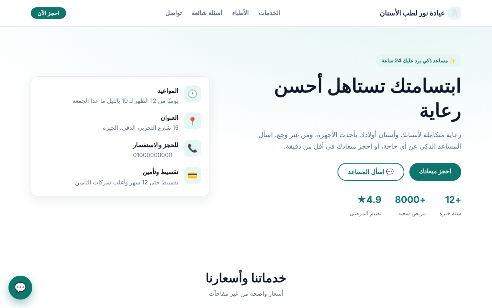

# 🦷 موقع عيادة + مساعد ذكي (AI Chatbot) — ديمو

موقع عربي كامل لعيادة أسنان، فيه شات بوت بيرد على المرضى من بيانات العيادة، وفورم حجز، ولوحة لعرض الحجوزات.
**القالب ده تقدر تغيّره لأي نشاط تاني (مطعم، عقارات، جيم، مركز تعليمي...) بإنك تعدّل ملف واحد بس: `data/clinic.json`.**



## المميزات
- موقع عربي RTL متجاوب مع الموبايل، وكل المحتوى بيتولد من ملف JSON
- شات بوت فيه وضعين:
  - **من غير API key:** بيرد من بيانات النشاط مباشرة عن طريق retrieval بالـ character n-grams، ومتظبط على اللهجة العامية وأشكال الحروف المختلفة. الوضع ده مجاني ومناسب للديمو.
  - **بمفتاح LLM:** بيعمل RAG، يعني بيجيب المعلومات المناسبة ويبعتها لأي API متوافق مع OpenAI (OpenAI أو Groq أو OpenRouter أو DeepSeek) عشان يكتب رد طبيعي بالمصري. ولو الـ API وقع، بيرجع لوضع الـ retrieval لوحده.
- البوت بيفهم نية الحجز، وبيطلّع زر بيودّي العميل على فورم الحجز
- فورم الحجز بيتأكد من صحة الرقم المصري، وبيحفظ الطلبات في CSV
- لوحة الحجوزات `/admin?token=...` فيها زر واتساب جنب كل عميل
- فيه rate limiting، والتاريخ اللي بيتبعت للـ LLM محدود عشان التكلفة
- الإجابات محصورة في بيانات النشاط، والبوت ممنوع يدّي تشخيص طبي

## التشغيل
```bash
python -m venv .venv && source .venv/bin/activate   # على ويندوز: .venv\Scripts\activate
pip install -r requirements.txt
uvicorn app.main:app --reload
```
افتح http://127.0.0.1:8000 ، ولوحة الحجوزات على http://127.0.0.1:8000/admin?token=demo123

### تفعيل الذكاء الاصطناعي (اختياري)
```bash
export LLM_API_KEY=sk-...
export LLM_BASE_URL=https://api.openai.com/v1   # أو https://api.groq.com/openai/v1
export LLM_MODEL=gpt-4o-mini
```

## النشر أونلاين (عشان تحط لينك لايف في البورتفوليو)
- **Render / Railway:** اربط الريبو، وأمر التشغيل هيبقى `uvicorn app.main:app --host 0.0.0.0 --port $PORT`
- أو استخدم Docker: `docker build -t clinic . && docker run -p 8000:8000 clinic`

## تخصيصه لعميل جديد
1. عدّل `data/clinic.json`: الاسم والخدمات والأسعار والأطباء والأسئلة الشائعة. وتقدر تضيف `tags` لأي سؤال عشان البوت يفهم كلمات مرادفة.
2. غيّر الألوان من أول ملف `static/style.css`، من المتغيرات `--brand` و`--brand-2`.
3. اكتب في `app/bot.py`، في الدالة `_system_prompt`، أسلوب الرد المناسب للنشاط.

## الهيكل
```
app/bot.py        محرك الشات بوت (retrieval + LLM اختياري)
app/main.py       FastAPI: الصفحة + /api/chat + /api/book + /admin
data/clinic.json  بيانات النشاط
templates/        صفحات HTML (Jinja2)
static/           CSS + JS للشات والفورم
```

> ديمو لعرض الإمكانيات، وكل البيانات والأسماء فيه وهمية.
