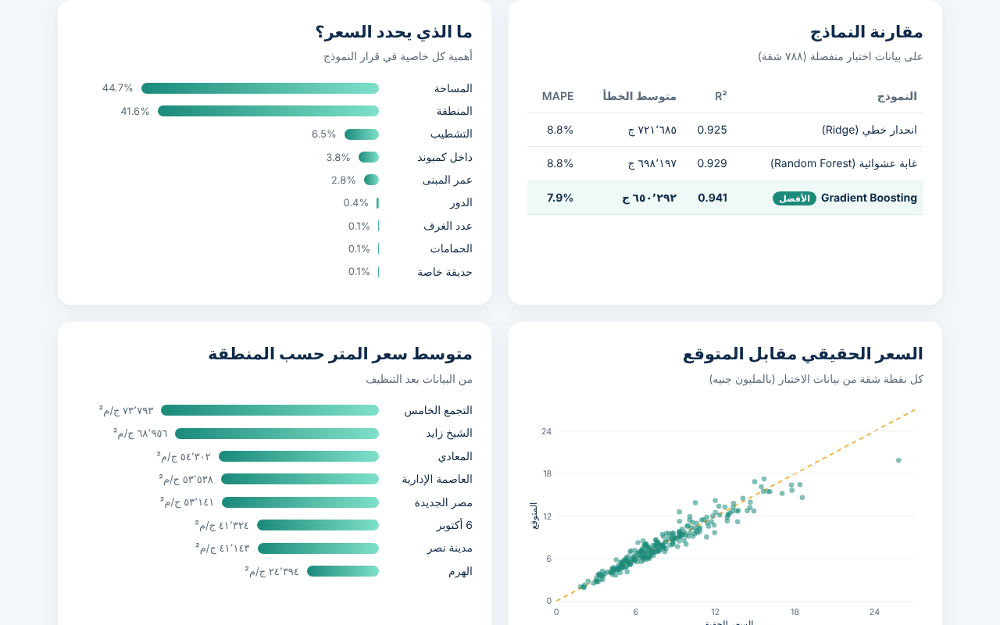

# تقدير أسعار الشقق بالذكاء الاصطناعي — Machine Learning Demo

مشروع تعلم آلي كامل: تنظيف البيانات ← هندسة الخصائص ← مقارنة 3 نماذج (Ridge, Random Forest, Gradient Boosting) مع Cross-Validation ← تقييم (R², MAE, MAPE) ← تصدير النموذج ليعمل مباشرة في المتصفح.

- `train.py` — توليد البيانات، التدريب، المقارنة، وتصدير النموذج إلى `static/model.json`
- `index.html` — صفحة عرض تفاعلية (حاسبة سعر + رسوم بيانية) تعمل بدون سيرفر

```bash
pip install scikit-learn pandas numpy
python train.py
python -m http.server 8000   # ثم افتح http://localhost:8000
```

> البيانات في هذا العرض مُولَّدة لأغراض التوضيح فقط وليست أسعارًا حقيقية للسوق.



