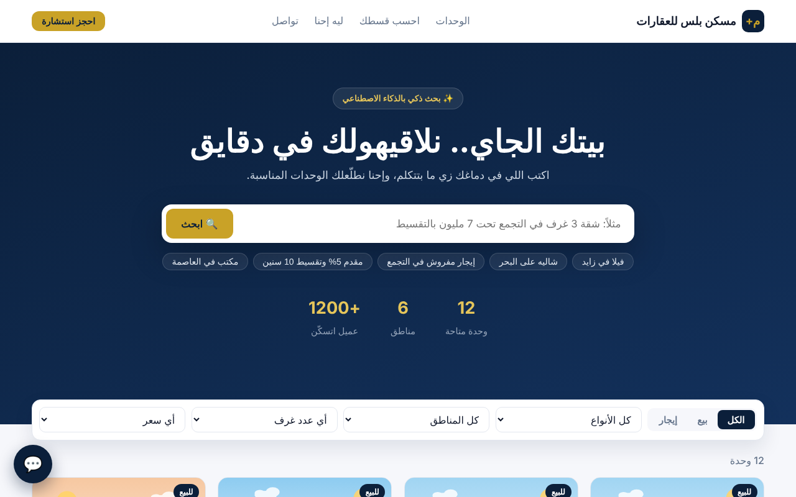
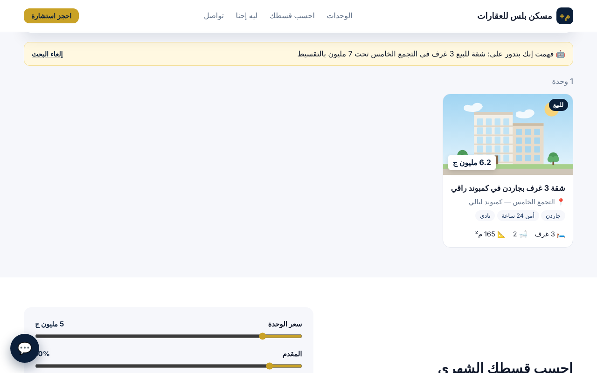
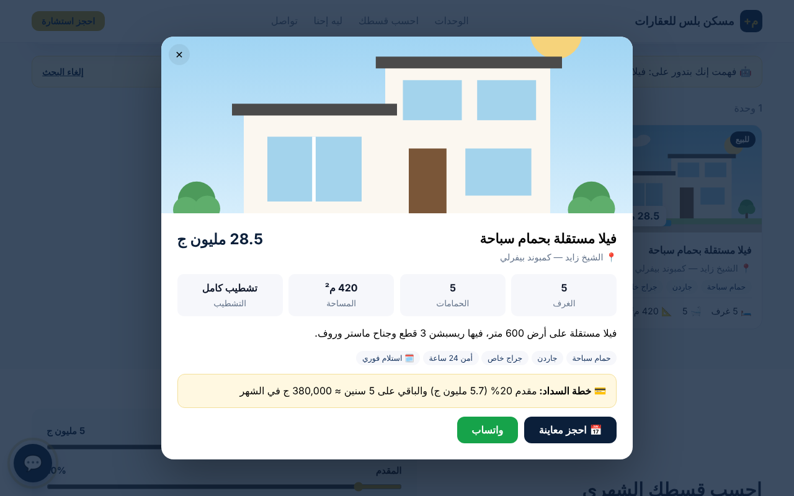
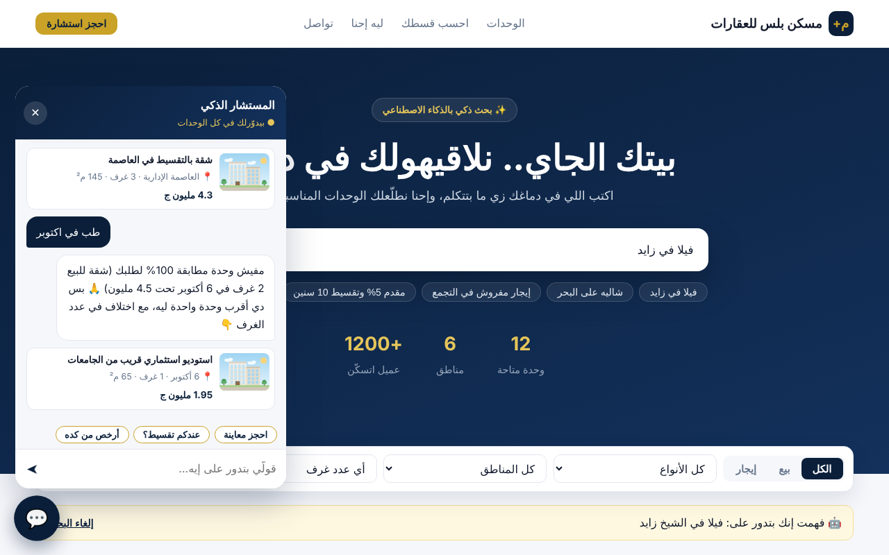
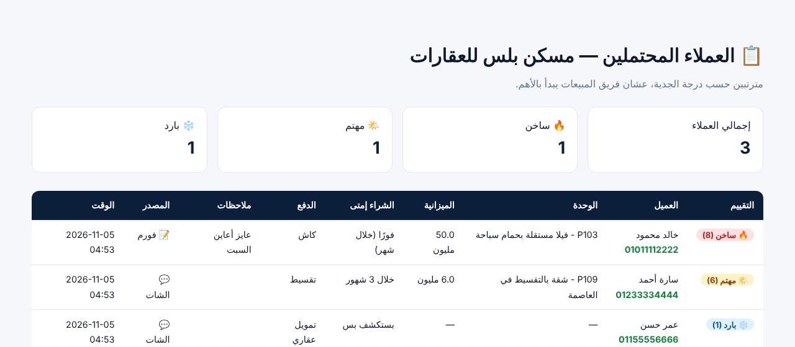

# 🏙️ موقع عقارات + بحث ذكي بالعامية + مستشار AI + تقييم العملاء — ديمو

موقع عقارات عربي فيه:
- بحث بالكلام العادي، زي «شقة 3 غرف في التجمع تحت 7 مليون بالتقسيط».
- مستشار ذكي بيعرض الوحدات المناسبة جوه الشات.
- حاسبة أقساط.
- نظام بيقيّم العملاء المحتملين ويرتبهم، عشان فريق المبيعات يبدأ بالأهم.



## المميزات
### 🔍 بحث ذكي بالعامية (`app/bot.py` → `parse_query`)
بيفهم من كلام العميل:
- **نوع الوحدة:** شقة، فيلا، تاون هاوس، دوبلكس، شاليه، أو مكتب.
- **الغرض:** بيع أو إيجار.
- **المنطقة،** حتى لو العميل كتب اسم مختصر، زي «زايد» أو «التجمع».
- **الميزانية:**
  - بيفهم الأرقام والكلمات زي «4 مليون ونص» و«مليونين» و«٣ مليون» و«20 ألف».
  - وبيفهم المقصود من «تحت» و«فوق» و«في حدود» و«من 3 لـ 5 مليون».
- **عدد الغرف،** حتى لو مكتوب بالكلام، زي «تلات غرف» أو «غرفتين» أو «استوديو».
- **المميزات،** زي جاردن وروف وفيو بحر ومفروش، و**التقسيط** و**الاستلام الفوري**.

ولو مفيش وحدة مطابقة 100%، **بيخفف الشروط واحد واحد** ويعرض أقرب اختيارات، وبيقول للعميل إيه بالظبط اللي مختلف عن طلبه.

### 💬 مستشار ذكي
- بيعرض الوحدات **ككروت جوه الشات**، وأي كارت بيفتح تفاصيل الوحدة.
- **بيفتكر الطلب اللي قبله**، فلو العميل قال «فيلا تحت 30 مليون» وبعدين «طب في زايد؟»، بيفهم إنه لسه بيدوّر على نفس الفيلا.
- بيرد على الأسئلة الشائعة، زي العمولة وطرق الدفع والأوراق.
- لو حطيت مفتاح LLM، الرد بيتكتب بالذكاء الاصطناعي **من نتايج البحث الحقيقية بس**، فمفيش أي وحدات متخترعة. ولو الـ API وقع، بيرجع للوضع العادي لوحده.

### 📊 تقييم العملاء (Lead Scoring)
- فورم المعاينة بيسأل عن الميزانية وإمتى هيشتري وطريقة الدفع.
- النظام بيدّي كل عميل درجة، وبيصنّفه: 🔥 ساخن، أو 🌤️ مهتم، أو ❄️ بارد.
- لوحة `/admin?token=...` بترتّب العملاء حسب الجدية، وجنب كل عميل زر واتساب، وبتبيّن جاي من الشات ولا من الفورم.

### كمان
- فلاتر سريعة.
- صفحة تفاصيل لكل وحدة فيها خطة السداد والقسط الشهري.
- حاسبة أقساط تفاعلية.
- رسومات SVG للوحدات (بدّلها بصور حقيقية).
- rate limiting.
- السيرفر بيتأكد من رقم الموبايل ومن كود الوحدة.

| البحث الذكي | تفاصيل الوحدة | المستشار | لوحة العملاء |
|---|---|---|---|
|  |  |  |  |

## التشغيل
```bash
python -m venv .venv && source .venv/bin/activate
pip install -r requirements.txt
uvicorn app.main:app --reload
```
افتح http://127.0.0.1:8000 ، ولوحة العملاء على http://127.0.0.1:8000/admin?token=demo123

## النشر على Render
- **Build:** `pip install -r requirements.txt`
- **Start:** `uvicorn app.main:app --host 0.0.0.0 --port $PORT`
- **Environment:** `ADMIN_TOKEN`، ولو عايز الذكاء الاصطناعي ضيف كمان `LLM_API_KEY` و`LLM_BASE_URL` و`LLM_MODEL`.

## تخصيصه لشركة جديدة
1. عدّل `data/realestate.json`: الوحدات والمناطق وأسماءها المختصرة (`aliases`) والأسئلة الشائعة.
2. لكل وحدة اختار رسمة من `art`: ‏apartment أو villa أو townhouse أو chalet أو office. أو ضيف صور حقيقية في `static/` وغيّر الدالة `img()` في `static/app.js`.
3. غيّر طريقة تقييم العملاء من `score_lead` في `app/main.py`.

> ديمو لعرض الإمكانيات، وكل الوحدات والأسعار والأسماء فيه وهمية.
