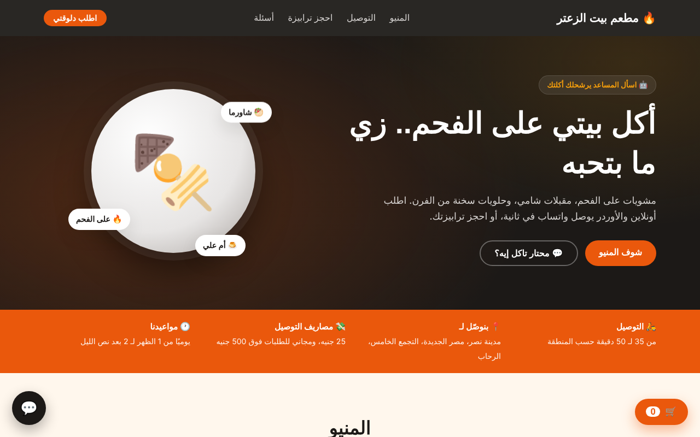
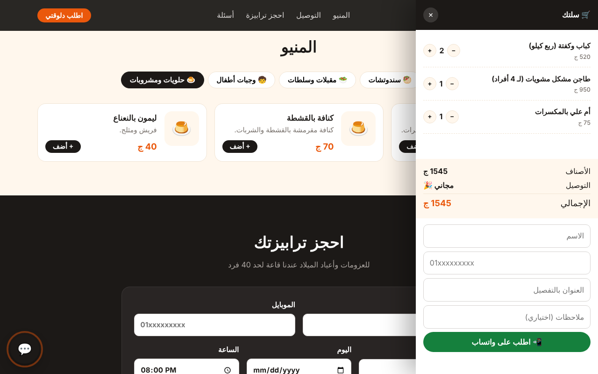
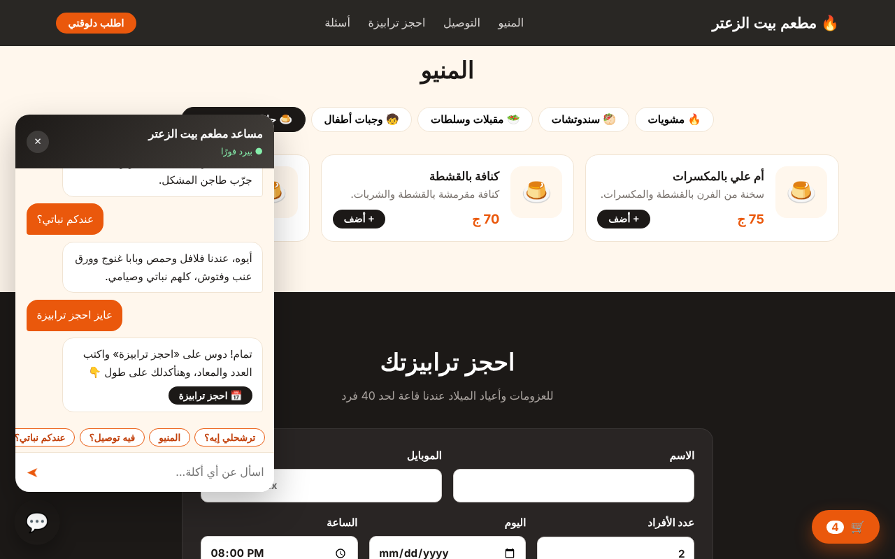
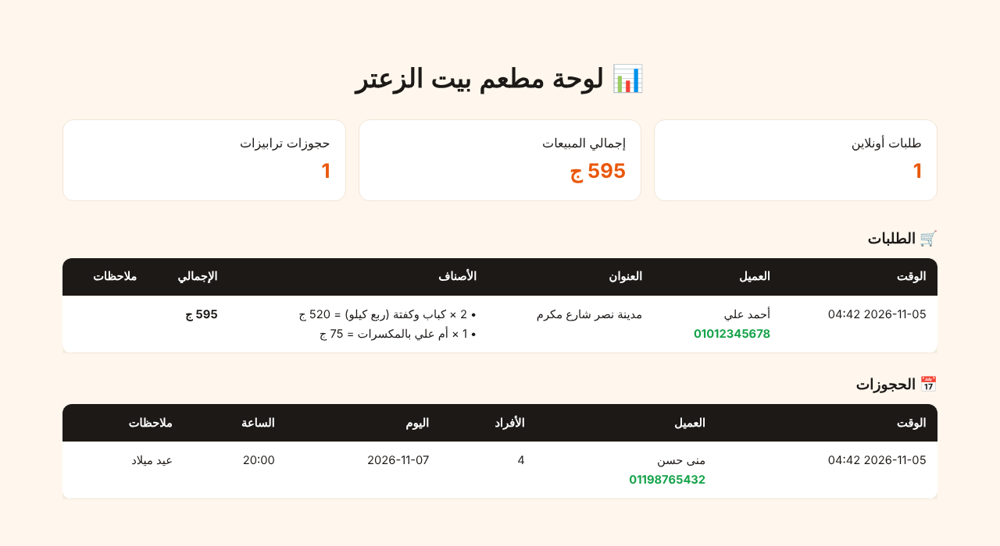

# 🔥 موقع مطعم + طلب أونلاين على واتساب + مساعد ذكي — ديمو

موقع عربي لمطعم فيه منيو تفاعلي وسلة طلبات بتبعت الأوردر جاهز على واتساب المطعم، وفيه كمان حجز ترابيزات، وشات بوت بيرشّح أكل ويرد على الأسعار والتوصيل، ولوحة فيها الطلبات والمبيعات.



## المميزات
- **منيو بالأقسام** وأيقونات، وعلامة على الأصناف «الأكثر طلبًا»، وكل ده بيتولد من `data/restaurant.json`.
- **سلة طلبات:**
  - بتحسب مصاريف التوصيل، وبتخلّيه مجاني فوق مبلغ معين، وبتطبّق الحد الأدنى للطلب.
  - الأسعار بتتحسب على السيرفر، فمحدش يقدر يغيّرها من المتصفح.
  - الأوردر بيتسجل، وبعدين بيتفتح واتساب برسالة جاهزة فيها الأصناف والإجمالي والعنوان.
- **حجز ترابيزات:** فيه عدد الأفراد واليوم والساعة والملاحظات.
- **شات بوت بالمصري:**
  - بيرشّح أكل، ويرد على الأسعار والتوصيل والدفع، وبيقترح أكل نباتي أو للأطفال.
  - لو العميل عايز يطلب، بيطلّعله زر يفتح المنيو. ولو عايز يحجز، بيطلّعله زر الحجز.
  - شغال من غير API key بالـ retrieval، ولو حطيت مفتاح بيشتغل بأي LLM متوافق مع OpenAI، ولو الـ API وقع بيرجع للـ retrieval لوحده.
- **لوحة إدارة** على `/admin?token=...`: فيها عدد الطلبات وإجمالي المبيعات والحجوزات، وزر واتساب لكل عميل.
- فيه rate limiting، والسيرفر بيتأكد من رقم الموبايل المصري ومن أكواد الأصناف.

| السلة | المساعد | لوحة الإدارة |
|---|---|---|
|  |  |  |

## التشغيل
```bash
python -m venv .venv && source .venv/bin/activate
pip install -r requirements.txt
uvicorn app.main:app --reload
```
افتح http://127.0.0.1:8000 ، ولوحة الإدارة على http://127.0.0.1:8000/admin?token=demo123

## النشر على Render
- **Build:** `pip install -r requirements.txt`
- **Start:** `uvicorn app.main:app --host 0.0.0.0 --port $PORT`
- **Environment:** `ADMIN_TOKEN`، ولو عايز الذكاء الاصطناعي ضيف كمان `LLM_API_KEY` و`LLM_BASE_URL` و`LLM_MODEL`.

## تخصيصه لمطعم جديد
1. عدّل `data/restaurant.json`: المنيو والأسعار والتوصيل والأسئلة. والـ `tags` بتساعد البوت يفهم الكلمات المرادفة.
2. غيّر قواعد التوصيل من أول `app/main.py`، من المتغيرات `FEE` و`FREE_OVER` و`MIN_ORDER`.
3. غيّر الألوان من المتغيرات اللي في أول `static/style.css`.

> ديمو لعرض الإمكانيات، وكل البيانات والأسماء فيه وهمية.
